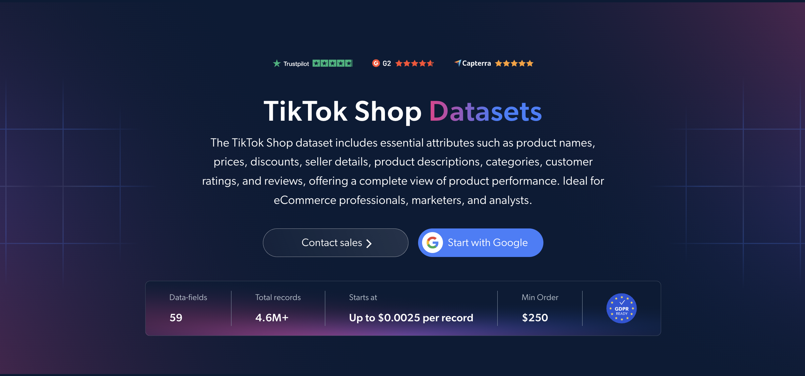

# TikTok Shop 数据集样本

<h2>包含 1000 款 TikTok Shop 商品的示例数据集</h2>

<a href="https://www.bright.cn/products/datasets/tiktok/shop">
   
</a>

包含 1000 款商品的 TikTok Shop 数据集示例。该数据集使用 <b>Bright Data API</b> 提取。

<h2>数据集包含的部分数据点：</h2>

* ```url```：TikTok Shop 商品页面的 URL
* ```id```：每款商品的唯一标识符
* ```title```：商品标题
* ```description```：商品完整描述
* ```brand```：商品品牌
* ```category```：商品类别
* ```category_tree```：商品类别路径，包括名称和 URL
* ```initial_price```：应用任何折扣前的原价
* ```final_price```：折扣后的最终价格
* ```discount_percent```：商品适用的折扣百分比
* ```currency```：商品价格的货币单位
* ```sold```：总销量
* ```In_stock```：商品是否有库存
* ```variations```：商品变体，例如颜色和尺寸
* ```shipping_fee```：商品运费
* ```prodct_rating```：商品平均评分
* ```reviews_count```：客户评论总数
* ```reviews```：商品的客户评论
* ```store_details```：店铺信息，包括名称、URL 和指标
* ```Shop_performance_metrics```：店铺绩效指标
* ```promotion_items```：当前有效的促销和优惠
* ```images```：商品图片的 URL
* ```related_videos```：与商品相关的 TikTok 视频

以及更多内容。

这是从“TikTok Shop（公开数据）”数据集中提取的示例子集，该完整数据集包含超过 <b>4,600,000 款商品</b>。

可用的数据集文件格式：<b>JSON、NDJSON、JSON Lines、CSV 或 Parquet。还可选择将文件压缩为 .gz 格式</b>。

数据集交付方式选项：<b>电子邮件、API 下载、Webhook、Amazon S3、Google Cloud Storage、Google Cloud PubSub、Microsoft Azure、Snowflake、SFTP</b>。

更新频率：<b>单次、每日、每周、每月、每季度、每半年或自定义频率</b>。

可在已提取数据点的基础上添加数据增强：<b>可根据需求提供。</b>

<b>[获取完整的 TikTok Shop 数据集](https://www.bright.cn/products/datasets/tiktok/shop)</b>。

<a href="https://www.bright.cn/products/datasets/tiktok/shop">
</a>

<h2>TikTok Shop 数据集有哪些使用场景？</h2>

<h3>1. 热门商品和市场分析</h3>
企业使用 TikTok Shop 数据集发现热门商品并了解消费者偏好。通过分析销量、价格和类别，公司可以评估市场状况、发现机会，并调整其社交电商策略。

<h3>2. 竞争对手和卖家分析</h3>
品牌通过分析店铺详情、店铺绩效指标、销量和商品评分，找出 TikTok Shop 上表现最佳的卖家。比较其策略有助于发现差异化、合作伙伴关系以及与创作者合作的机会。

<h3>3. 价格和折扣追踪</h3>
公司持续追踪 TikTok Shop 商品的原价、最终价格、折扣和当前促销活动。这有助于企业对标自身定价，并合理安排促销时机，从而有效参与竞争。

<h2>面向学术研究人员和 NGO 免费开放网页爬虫工具和数据集</h2>

Bright Initiative 向顶尖学术院系和研究人员，以及致力于推动各类环境与社会事业的 NGO 和 NPO，开放 Bright Data 的 <b>[爬虫工具 API](https://www.bright.cn/products/web-scraper)</b> 和 <b>[即用型数据集](https://www.bright.cn/products/datasets)</b>。你可以在<b>[此处](https://brightinitiative.com)</b>提交申请。
